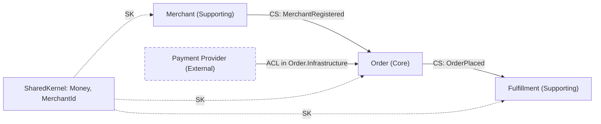

# Context map

## Contexts

| Context | Type | Purpose | Status |
|---------|------|---------|--------|
| Merchant | Supporting | Business record: address, VAT number, bank details | Active |
| Order | Core | Taking orders and fulfilment | Active |
| Fulfillment | Supporting | Shipment from merchant to customer | Active |
| Payment Provider | External | Card payments, third party | Active |
| SharedKernel | Shared Kernel | `Money`, `MerchantId` | Active |

## Relationships

| Upstream | Downstream | Pattern | Mechanism | Contract | Source |
|----------|------------|---------|-----------|----------|--------|
| Merchant | Order | Customer-Supplier | `MerchantRegistered` integration event, translator in Order | `Merchant.Contract/Events/MerchantRegistered` | ord-0005 |
| Order | Fulfillment | Customer-Supplier | `OrderPlaced` integration event, translator in Fulfillment | `Order.Contract/Events/OrderPlaced` | ful-0002 |
| Payment Provider | Order | Anti-Corruption Layer | REST adapter plus translator in `Order.Infrastructure/Payment/` | Provider API document | ord-0009 |

## Diagram

Arrows point from upstream to downstream. Edge label: pattern short code and mechanism. External systems have a dashed border. Shared Kernel links are dotted.

