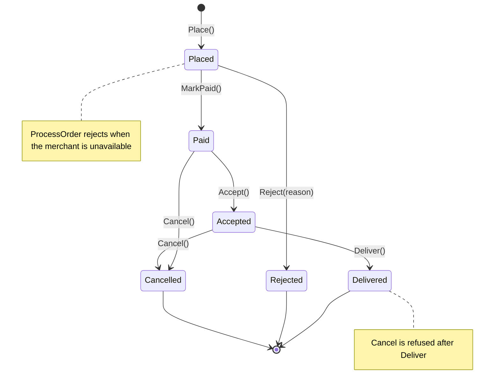

# Order lifecycle

Transition labels are the aggregate's methods. Notes are the invariants that refuse a transition. A state with no transition for a method means that method is refused there.

Ledger: ord-0017
