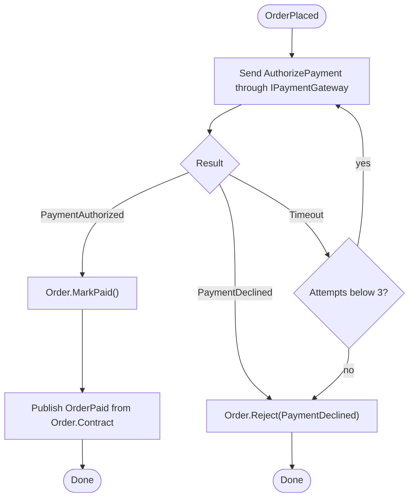

# OrderPaymentProcess

Saga in `Order.Application/Processes/` (U12). It uses the `IPaymentGateway` port, which is the port of the anti-corruption layer towards the Payment Provider. Shows the compensation branch and the retry.

Ledger: ord-0021
