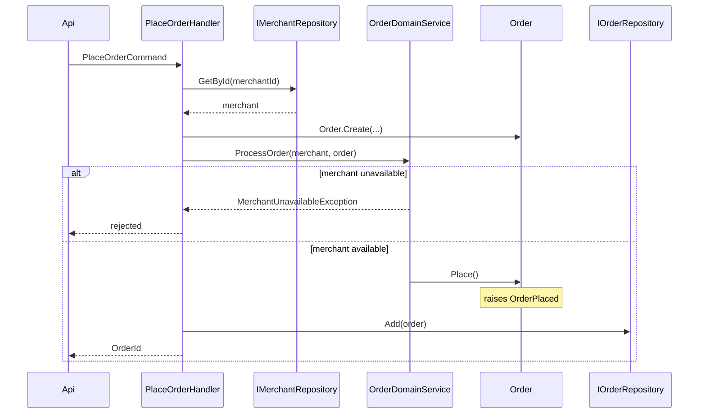

# PlaceOrder

Command flow inside the Order context. Shows the repository port (U4), the port-free domain service (U5), the typed exception (U7) and the aggregate raising its event.

Ledger: ord-0003
