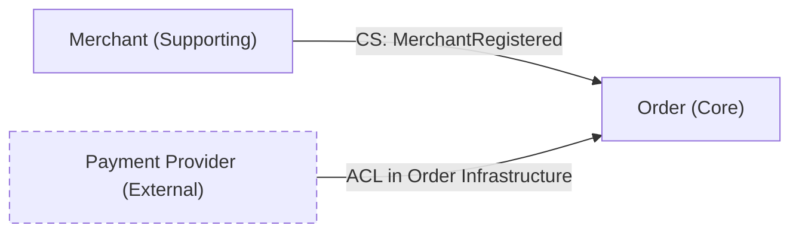

# Context map

One file for the whole repo: `ubiqron/CONTEXT-MAP.md`. It answers three questions: which contexts exist and what type they are, who feeds whom and by which pattern, and where the contract lives in code. It is a projection of the ledgers: every relationship row comes from a `ContextRelationshipChanged` line.

## Template

```markdown
# Context map

## Contexts

| Context | Type | Purpose | Status |
|---------|------|---------|--------|
| Merchant | Supporting | Business record: address, VAT number, bank details | Active |
| Order | Core | Taking orders and fulfilment | Active |
| Payment Provider | External | Card payments, third party | Active |
| SharedKernel | Shared Kernel | Money, MerchantId | Active |

## Relationships

| Upstream | Downstream | Pattern | Mechanism | Contract | Source |
|----------|------------|---------|-----------|----------|--------|
| Merchant | Order | Customer-Supplier | MerchantRegistered integration event, translator in Order | Merchant.Contract/Events/MerchantRegistered | ord-0005 |
| Payment Provider | Order | Anti-Corruption Layer | REST adapter plus translator in Order Infrastructure | Provider API document, link | ord-0009 |

## Diagram

(optional, see below)
```

## Columns

| Column | Values |
|--------|--------|
| Type | Core, Supporting, Generic, External, Shared Kernel |
| Status | Planned, Active, Deprecated |
| Purpose | One sentence, plain English |
| Pattern | One of the nine full names: Customer-Supplier, Anti-Corruption Layer, Open Host Service, Published Language, Shared Kernel, Conformist, Partnership, Separate Ways, Big Ball of Mud |
| Mechanism | Free text: what carries the data and where the translation sits |
| Contract | Path of the published type in the repo, or the document link for an external system |
| Source | Id of the downstream context's `ContextRelationshipChanged` line |

External systems and the Shared Kernel are rows in the contexts table. There is no team or owner column.

A Shared Kernel row in the relationships table is optional. Write one when more than one context uses the SharedKernel module: Upstream `SharedKernel`, Pattern `Shared Kernel`, Mechanism `module reference`, Contract `SharedKernel module`, Source the downstream id.

## Ledger link

A relationship change writes one line in each ledger, each from its own side. The Source column shows the downstream id.

Upstream ledger, Merchant:

```jsonl
{"id":"mer-0004","at":"2026-11-06","context":"Merchant","kind":"ContextRelationshipChanged","subject":"Order","to":"upstream, Customer-Supplier, MerchantRegistered","reason":"Order needs to know which merchants exist and whether they are available","related":"Order:ord-0005"}
```

Downstream ledger, Order:

```jsonl
{"id":"ord-0005","at":"2026-11-06","context":"Order","kind":"ContextRelationshipChanged","subject":"Merchant","to":"downstream, Customer-Supplier, MerchantRegistered","reason":"Order needs to know which merchants exist and whether they are available","related":"Merchant:mer-0004"}
```

- `subject` is the other context.
- `to` names the role, the pattern and the mechanism, comma separated.
- A pattern change writes the same two lines with `from` holding the old pattern.
- An external system has no ledger. The downstream writes one line with no `related`.
- Removing a relationship: `to` is `none`, `from` holds the old pattern. The row is deleted from the map.

## Procedure

1. Propose rows in the reply: at most three relationships. Use the proposal table in `references/strategic-design.md`.
2. After the developer agrees: read the last id in both ledgers, compute both new ids, write both lines.
3. Add or update the rows in `ubiqron/CONTEXT-MAP.md`. Create the file from the template if it does not exist.
4. When the contexts table has more than five rows, or the developer asks, add or redraw the diagram section with the rules in `references/diagrams.md`.
5. Reply with the rows written and the two ledger ids.

The developer may edit the file by hand. Review mode reports a row with no matching reference in code, and a reference in code with no row.

## Diagram section



One node per row of the contexts table, type in brackets. One arrow per row of the relationships table, upstream to downstream, labelled with the pattern code and the mechanism. Dashed border for External. Dotted arrows for Shared Kernel. No colours. A full sample is in `examples/diagrams/CONTEXT-MAP.md`.

## Questions the map answers

| Question | Where |
|----------|-------|
| Which contexts exist, and which are only planned? | Contexts table, Status column |
| Who may reference whom in code? | Relationships table; U9 allows only the Contract module |
| Where is the published type for X? | Contract column |
| Why does this relationship exist? | Follow Source to the ledger line and its `related` partner |
| Which contexts are core? | Type column |
